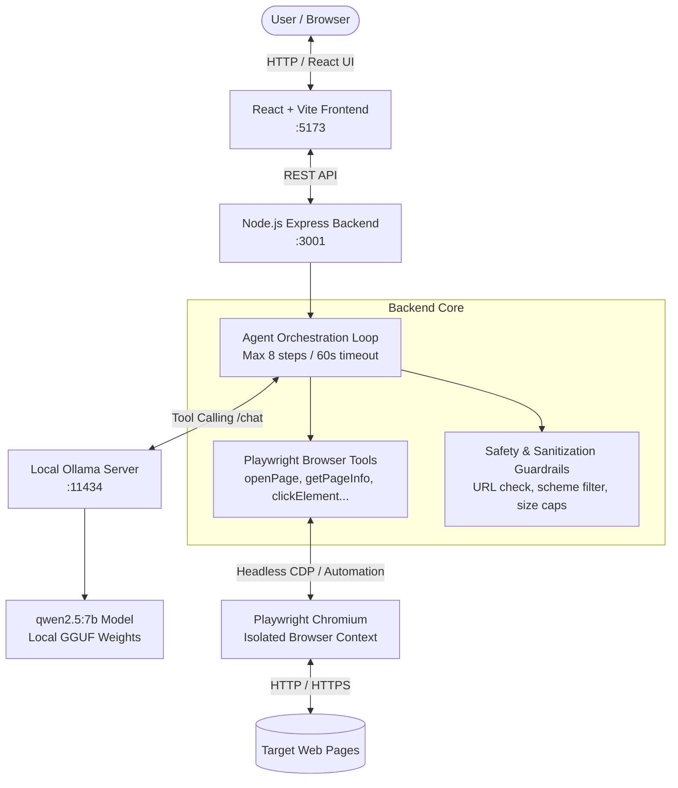
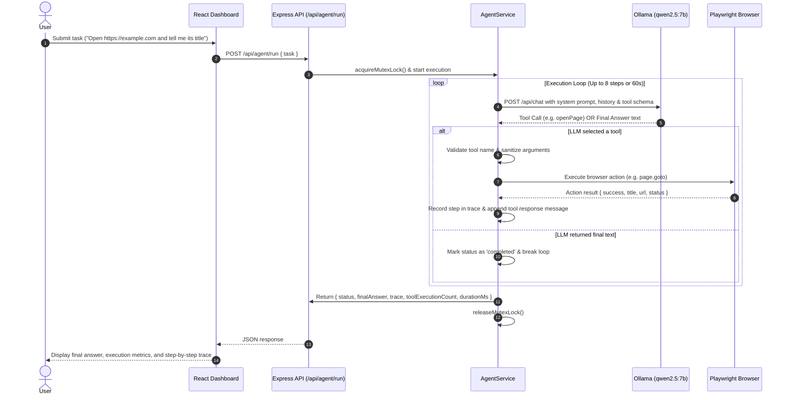

# WebPilot AI — Autonomous Local Browser Agent

> An open-source, local-first AI browser agent that executes web automation tasks via Playwright and local LLM function calling (Ollama `qwen2.5:7b`), operating under a strict ₹0 cloud budget.

---

## 1. Project Overview & Problem Statement

Modern browser automation typically forces developers into one of two compromises:
1. **Fragile procedural scripts**: Traditional automation (Puppeteer, Selenium) breaks whenever a website updates its DOM structure or styling.
2. **Expensive, privacy-invasive cloud AI agents**: Cloud-based browser agents incur per-token API costs, leak browsing sessions and confidential data to third-party endpoints, and introduce external network dependencies.

**WebPilot AI** solves this by pairing a deterministic browser automation engine (**Playwright**) with a locally hosted large language model (**Qwen 2.5 7B via Ollama**) through structured tool calling. All inference, browser control, and execution loops run entirely on the user's local machine with **zero external API calls and zero cloud subscription costs**.

---

## 2. Architecture & Design

### High-Level Architecture



### Agent Execution Loop

The agent follows an iterative, deterministic tool-calling loop:



---

## 3. Tech Stack & Architectural Decisions

| Component | Technology | Rationale |
|---|---|---|
| **Frontend** | React 19, Vite, Tailwind CSS, Lucide Icons | Fast dev server, minimal bundle size (72 kB gzipped), reactive status indicators and structured execution trace visualization. |
| **Backend** | Node.js (v22+), Express 5 (ES Modules) | Native asynchronous I/O matching Playwright promises, built-in Node test runner (`node --test`), lightweight REST architecture. |
| **Browser Engine** | Playwright (Chromium) | Reliable automation with isolated browser contexts, auto-waiting, deterministic selectors, and clean process lifecycle management. |
| **Local LLM Runtime** | Ollama (v0.4+) | Fast local inference engine exposing standard OpenAI-compatible and Ollama `/api/chat` endpoints with native tool calling support. |
| **Model** | `qwen2.5:7b` (4.7 GB) | Superior reasoning and function-calling accuracy among sub-10B open models, comfortably running locally on consumer hardware. |

---

## 4. Implemented Features & Tool Capabilities

### Registered Browser Tools
The model can autonomously select from 5 registered browser tools:

1. **`openPage({ url })`**: Navigates to an HTTP/HTTPS address with standard 15s timeout and `domcontentloaded` wait.
2. **`getPageInfo()`**: Retrieves current page metadata (`url`, `title`, HTTP status code).
3. **`getPageContent({ maxLength? })`**: Extracts visible, structured text from the page body (sanitized and clamped to 20,000 characters).
4. **`clickElement({ selector })`**: Simulates user click on interactive elements with a 4s action timeout.
5. **`fillInput({ selector, text })`**: Fills text input fields or search bars with an 8s action timeout.

### Reliability & Fault Tolerance
- **Execution Budget**: Hard cap of **8 tool steps** per task to eliminate runaway loops.
- **Task Timeout**: Enforced **60-second** overall execution timeout.
- **Concurrency Mutex**: In-memory task lock (`agentLock`) prevents concurrent tasks from corrupting shared browser page state.
- **Structured Statuses**: Always returns one of three deterministic statuses: `completed`, `failed`, or `limit_reached`.
- **Structured Trace**: Every step records `step`, `tool`, `args`, `status`, `durationMs`, and output `result` or `error`.
- **Ollama Error Handling**: Gracefully catches connection drops, model timeouts (50s), and invalid JSON without crashing.

### Safety & Guardrails
- **Scheme Filtering**: Strictly restricts navigation to `http:` and `https:`. Explicitly rejects `file:`, `javascript:`, `data:`, `ftp:`, and `about:blank`.
- **No Arbitrary Code Execution**: No `eval()`, shell execution, or dynamic script injection is permitted.
- **Untrusted Content Sanitization**: Web page content is treated strictly as untrusted data in the prompt context.
- **Private IP Audit Policy**: Navigation to `localhost` and RFC-1918 private ranges (`10.0.0.0/8`, `172.16.0.0/12`, `192.168.0.0/16`) is permitted for local development testing, but flagged (`isPrivate: true`) and audited.
- **Secret Protection**: API responses and logs strip environment variables, cookies, and internal headers.

---

## 5. Project Directory Structure

```
D:\Gen_ai_project/
├── .gitignore               # Root git ignore (node_modules, .env, playwright, logs)
├── package.json             # Root scripts (smoke test, backend tests, frontend build)
├── smoke-test.js            # Standalone Playwright browser sanity test
├── day1_audit_report.md     # Day 1 milestone verification
├── backend/
│   ├── .env.example         # Template for backend environment variables
│   ├── package.json         # Backend dependencies (express, cors, dotenv)
│   ├── src/
│   │   ├── server.js        # Express HTTP server setup and route mounting
│   │   ├── routes/
│   │   │   ├── health.js    # /api/health and /api/ollama/status
│   │   │   └── agent.js     # POST /api/agent/run and GET /api/agent/status
│   │   └── services/
│   │       ├── agentService.js   # Orchestration loop, LLM call, mutex lock
│   │       ├── browserTools.js   # Playwright automation functions & URL validation
│   │       └── ollamaService.js  # Ollama health, tags, and chat completions
│   └── tests/
│       ├── agent.test.js    # Agent validation, loop mocking, and live integration
│       ├── browser.test.js  # Playwright browser lifecycle and tool tests
│       └── day5.test.js     # 41 regression tests for safety, limits, and reliability
└── frontend/
    ├── .env.example         # Template for frontend environment variables
    ├── .gitignore           # Frontend-specific ignore rules
    ├── index.html           # Single-page HTML entry point
    ├── vite.config.js       # Vite configuration with React plugin
    └── src/
        ├── App.jsx          # Main dashboard, task runner, and execution trace UI
        ├── main.jsx         # React application mounting
        └── index.css        # Tailwind CSS and design utilities
```

---

## 6. Prerequisites & Setup (Windows)

### Prerequisites
- **Node.js**: v22.0.0 or higher
- **Ollama**: v0.4.0 or higher ([Download for Windows](https://ollama.com/download))
- **Model**: `qwen2.5:7b` (stored locally, e.g., in `D:\ollama_models`)

### 1. Configure and Start Ollama
Ensure your model storage directory is configured via the environment variable `OLLAMA_MODELS` if stored outside default user profile:

```powershell
# Set model storage path if needed
$env:OLLAMA_MODELS = "D:\ollama_models"

# Start the Ollama server
ollama serve
```

Verify that the model is loaded:
```powershell
ollama list
# Should list qwen2.5:7b
```

### 2. Configure Backend
```powershell
cd D:\Gen_ai_project\backend

# Copy environment template
cp .env.example .env

# Install dependencies (already committed lockfile)
npm install

# Start backend in development mode
npm run dev
# Server listens on http://localhost:3001
```

### 3. Configure Frontend
```powershell
cd D:\Gen_ai_project\frontend

# Copy environment template
cp .env.example .env

# Install dependencies
npm install

# Start frontend in development mode
npm run dev
# Dashboard available on http://localhost:5173
```

---

## 7. Environment Variables

### Backend (`backend/.env`)
| Variable | Default Value | Description |
|---|---|---|
| `PORT` | `3001` | Port number the Express API server listens on. |
| `OLLAMA_BASE_URL` | `http://localhost:11434` | Base HTTP address where Ollama daemon is reachable. |

### Frontend (`frontend/.env`)
| Variable | Default Value | Description |
|---|---|---|
| `VITE_API_BASE_URL` | `http://localhost:3001` | Base URL used by the React client to make backend API calls. |

---

## 8. API Specification

### `GET /api/health`
Returns backend service availability and metadata.
- **Response `200 OK`**:
```json
{
  "status": "ok",
  "service": "webpilot-ai-backend",
  "version": "0.1.0",
  "timestamp": "2026-10-25T11:34:37.806Z"
}
```

### `GET /api/ollama/status`
Checks if Ollama is running and verifies whether `qwen2.5:7b` is downloaded and ready.
- **Response `200 OK`**:
```json
{
  "status": "ok",
  "reachable": true,
  "modelReady": true,
  "reason": "ready",
  "message": "Model 'qwen2.5:7b' is available and ready for agent tasks.",
  "ollamaUrl": "http://localhost:11434",
  "requiredModel": "qwen2.5:7b",
  "activeModel": "qwen2.5:7b",
  "modelCount": 1,
  "models": [{ "name": "qwen2.5:7b", "size": 4683087332 }]
}
```

### `GET /api/agent/status`
Checks if the browser agent is currently executing a task.
- **Response `200 OK`**:
```json
{
  "status": "ok",
  "busy": false
}
```

### `POST /api/agent/run`
Submits a task string to the autonomous browser agent loop.
- **Request Body**:
```json
{
  "task": "Open https://example.com and tell me its page title."
}
```
- **Response `200 OK` (Completed)**:
```json
{
  "status": "ok",
  "data": {
    "status": "completed",
    "finalAnswer": "The page title of the example.com website is \"Example Domain\".",
    "trace": [
      {
        "step": 1,
        "tool": "openPage",
        "args": { "url": "https://example.com" },
        "status": "success",
        "result": {
          "success": true,
          "url": "https://example.com/",
          "title": "Example Domain",
          "status": 200
        },
        "durationMs": 4532
      }
    ],
    "toolExecutionCount": 1,
    "durationMs": 53630
  }
}
```

- **Response `409 Conflict` (Concurrent Task Locked)**:
```json
{
  "status": "error",
  "code": "CONCURRENT_TASK_LOCKED",
  "message": "Another task is already running. Please wait for it to complete."
}
```

- **Response `400 Bad Request` (Invalid Input)**:
```json
{
  "status": "error",
  "code": "INVALID_TASK",
  "message": "Task must be a string of at most 2000 characters."
}
```

---

## 9. Verification & Testing

### Running Tests

```powershell
# Run the Playwright browser sanity smoke test
npm run smoke

# Run all backend unit, safety, mocked, and live integration tests
npm test

# Build frontend production bundle
npm run build:frontend
```

### Actual Test Coverage & Results

| Test Suite | Scope / Type | Checks | Passing | Failing |
|---|---|---|---|---|
| **Smoke Test (`smoke-test.js`)** | Standalone real Playwright Chromium launch & assertions | 4 | 4 | 0 |
| **`browser.test.js`** | Playwright tools lifecycle, navigation, and error handling | 14 | 14 | 0 |
| **`agent.test.js`** | Tool validation, mocked loop edge cases, and HTTP API tests | 19 | 19 | 0 |
| **`agent.test.js` (Live)** | Real Ollama `qwen2.5:7b` + Playwright live browser test | 1 | 1 | 0 |
| **`day5.test.js` (A)** | URL safety & private IP detection rules [UNIT] | 14 | 14 | 0 |
| **`day5.test.js` (B)** | Agent reliability, timeouts, and mutex concurrency [MOCKED] | 9 | 9 | 0 |
| **`day5.test.js` (C)** | Safety: forbidden tools rejection & sanitization [UNIT] | 11 | 11 | 0 |
| **`day5.test.js` (D)** | Content extraction boundary clamps [UNIT] | 3 | 3 | 0 |
| **`day5.test.js` (E)** | HTTP API validation and status endpoint [INTEGRATION-HTTP] | 4 | 4 | 0 |
| **Frontend Build** | Vite production compilation (`dist/`) | 1 | 1 | 0 |
| **Total** | **All Automated Quality Checks** | **80** | **80** | **0** |

---

## 10. Troubleshooting

### 1. Ollama Connection Error (`ECONNREFUSED 127.0.0.1:11434`)
- **Cause**: The Ollama background process is not active.
- **Fix**: Open a terminal and run `ollama serve`. Verify with `curl http://localhost:11434/api/tags`.

### 2. Model Not Found (`modelReady: false`)
- **Cause**: The `qwen2.5:7b` weights are not in the active Ollama models directory.
- **Fix**: Check `ollama list`. If models are on another drive, set `$env:OLLAMA_MODELS = "D:\ollama_models"` before launching `ollama serve`.

### 3. Playwright Browser Executable Missing
- **Cause**: Playwright Chromium binaries were not initialized.
- **Fix**: Run `npx playwright install chromium` from the workspace root.

### 4. Port Conflict (`EADDRINUSE: 3001` or `5173`)
- **Cause**: An earlier backend or frontend process is still bound to the port.
- **Fix**: Identify and kill the process:
  ```powershell
  Get-NetTCPConnection -LocalPort 3001 | Select-Object OwningProcess
  Stop-Process -Id <PID>
  ```

---

## 11. Security Considerations

1. **Local-Only Boundary**: WebPilot AI operates without external telemetry or cloud credentials. Secrets and API keys are not sent across the internet.
2. **Untrusted Page Input**: Content scraped from websites is strictly bounded and treated as text data, mitigating indirect prompt injection attempts.
3. **Internal Network / SSRF Awareness**: Requests to internal addresses (`localhost`, private RFC-1918 IPs) are flagged and logged for local development auditability. Non-HTTP protocols (`file:`, `javascript:`) are hard-blocked.
4. **No Destructive Capabilities**: The agent does not expose file writes, terminal execution, or credential vaults to the model.

---

## 12. Future Improvements

- **Streaming Execution Events (SSE)**: Stream individual trace steps to the UI in real time rather than batching on completion.
- **Per-Task Browser Context Isolation**: Spin up an isolated browser context per task to ensure cookies and cache do not persist across different tasks.
- **Visual Screenshot Tool**: Register a `takeScreenshot()` tool to present visual snapshots in the execution trace.
- **Local Storage Task History**: Persist past agent runs and execution metrics in browser local storage.
